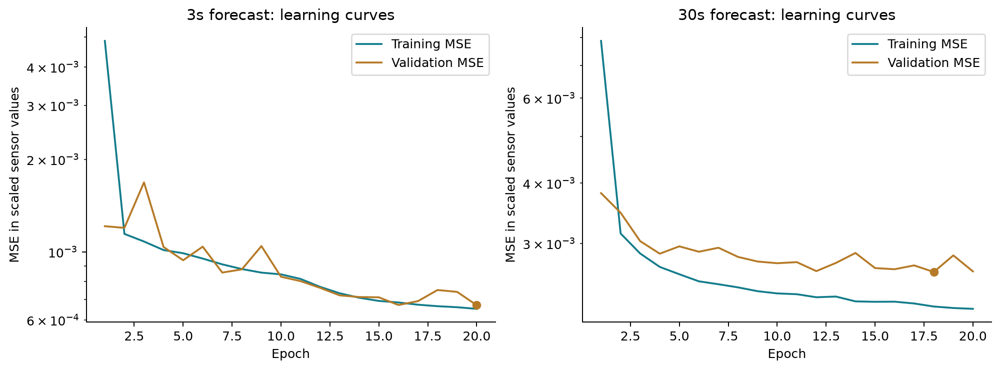
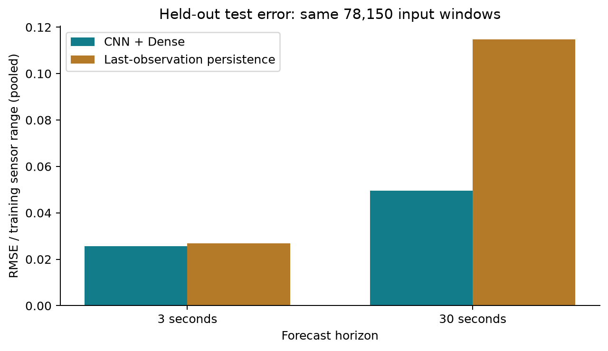
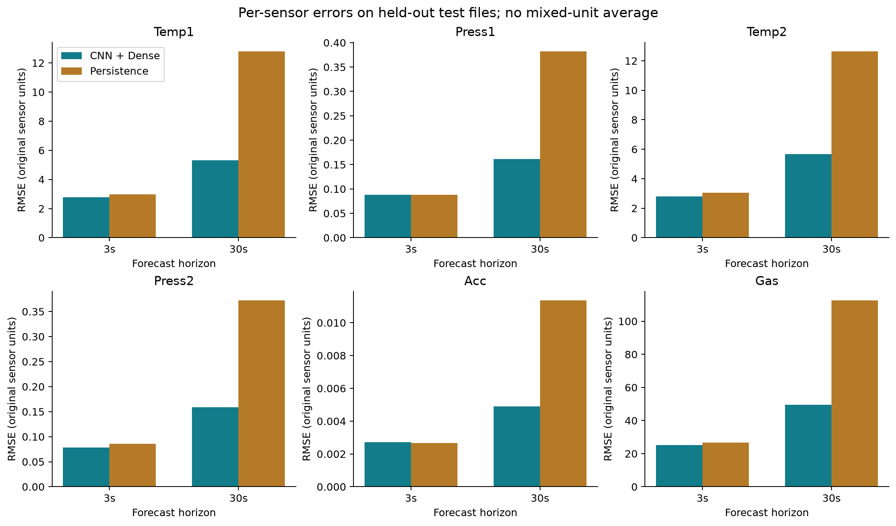
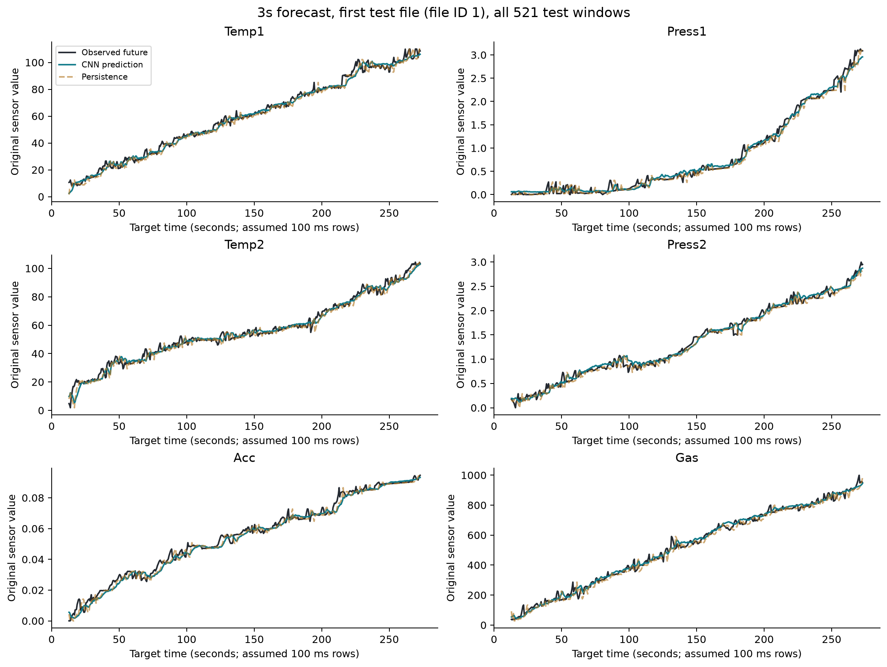
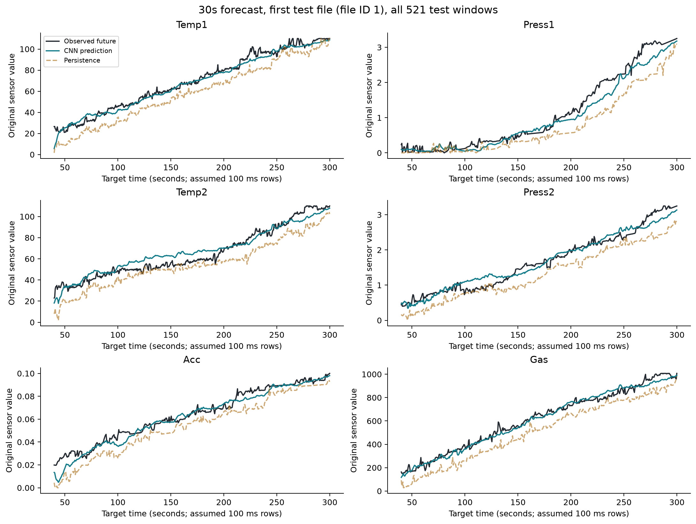

# 인공지능학습데이터전처리 과제4

가스환경 데이터의 3초 후·30초 후 센서값 예측 비교

작성 및 실험 결과 생성: 2026-11-03 11:28 KST. 제출 기한: 2026년 11월 10일 오전 9시(KST).

## 1. 과제 조건과 실험에서 선택한 사항

과제 조건은 가스환경 데이터로 3초 후와 30초 후를 예측하고, TensorFlow에서 CNN과 Dense 레이어만 사용하며, 컬럼별 0~1 스케일링과 전처리·학습 데이터 구축·모델 구성·결과를 설명하는 것이다. 교수님 지침에 따라 센서 6개를 한 번의 추론에서 함께 예측한다.

센서 6개 동시 예측은 교수님 지침에 해당하며, 입력에도 index를 제외한 과거 센서 6개를 사용했다. 입력 길이 100개, 미래 두 시점 각각의 한 관측값 예측, 파일 분할 비율 70:15:15, 윈도우 이동 간격 5행은 실험의 설계 선택이다. 미래 3초 또는 30초 동안의 전체 시퀀스를 예측하는 실험은 아니다.

시간 간격은 원본 그래프의 100ms 표시에 근거한다. 검토 과정에서 원본 `_Merged_Data_data_set_00000.png`의 가로축이 실제로 `Timestamp(100 ms)`임을 확인했다. CSV index는 모든 파일에서 1씩 증가하며, 그래프의 시간 간격을 적용하면 3초는 30행, 30초는 300행이다. 관측치 100개의 첫 값과 마지막 값 사이 시간은 9.9초이다. CSV 자체에 별도의 물리적 시각 컬럼이 있는 것은 아니다.

## 2. Linux 실행 환경과 원본 데이터 검사

Linux 컨테이너(Debian 13, WSL2 기반), Python 3.12.14, TensorFlow 2.21.0, NumPy 2.5.2에서 실행했다. GPU는 NVIDIA GeForce RTX 3080(VRAM 10GiB)이며, 실제 CNN 순전파와 train_on_batch 연산의 GPU 실행을 확인했다. 기존 패키지를 사용했고 설치·업그레이드를 하지 않았다. Flower 관련 코드를 수정하지 않았다.

사용 경로는 `/workspace/DataSet_00000_00999/_Merged_Data`이다. 통합 CSV 1,000개만 사용하고 PNG와 개별 센서 폴더의 중복 CSV는 합치지 않았다. 검사 결과 모든 파일이 헤더 없는 숫자 데이터 3,000행 × 7열이고 총 3,000,000행이었다. NaN과 무한대는 없었다. 컬럼은 제공된 명세에 따라 index, Temp1, Press1, Temp2, Press2, Acc, Gas 순서로 해석했다. 센서 이름과 물리 단위는 CSV 자체의 헤더로 검증한 것은 아니다.

CSV는 NumPy loadtxt에서 첫 행을 건너뛰지 않고 읽었다. pandas의 header=None에 해당하는 처리이다. index는 파일 내 행 순서 검사에만 사용하고 모델 입력과 정답에서 제외했다. 센서별 0은 Temp1 53,537개, Press1 32,977개, Temp2 56,316개, Press2 36,340개, Acc 40,176개, Gas 51,518개였으며, 임의의 결측값으로 간주하거나 삭제하지 않았다. 초기 관측치도 제거하지 않았다.

## 3. 파일 분할과 컬럼별 스케일링

윈도우를 만들기 전에 CSV 경로를 정렬한 뒤 NumPy default_rng(42)로 섞어 학습 700개, 검증 150개, 시험 150개로 분할했다. 동일 파일의 겹치는 윈도우가 여러 분할에 들어가면 누수가 발생할 수 있어 파일 단위로 분리했다. 분할 목록과 원본 SHA-256을 split_manifest.json에 저장했다. 경로 중복과 누락이 없고, 원본 내용이 완전히 동일한 파일도 분할 사이에 없었다. 내용이 비슷한 파일의 통계적 독립성까지 증명한 것은 아니다.

센서별 학습 최솟값 m과 최댓값 M을 학습 파일에서만 계산하고, z = (x - m) / (M - m)으로 변환했다. 같은 센서의 입력 X와 정답 y에 동일한 m, M을 적용했다. index는 스케일링하지 않았다. 센서별 범위를 맞추면 값이 큰 Gas가 학습 손실을 과도하게 지배하는 것을 줄일 수 있다.

| 센서 | 학습 최솟값 | 학습 최댓값 | 검증 범위 밖 개수 | 시험 범위 밖 개수 |
| --- | --- | --- | --- | --- |
| Temp1 | 0.0 | 110.0 | 0 | 0 |
| Press1 | 0.0 | 3.25 | 0 | 0 |
| Temp2 | 0.0 | 110.0 | 0 | 0 |
| Press2 | 0.0 | 3.25 | 0 | 0 |
| Acc | 0.0 | 0.1 | 0 | 0 |
| Gas | 0.0 | 1007.0 | 0 | 0 |

상수 컬럼은 없었다. 검증·시험 데이터에서 학습 범위를 벗어난 값도 없었다. 코드는 범위 밖 값에 대비하여 변환 후 [0,1] clipping을 적용하지만, 이번 데이터에서는 변경된 값이 0개이다. 일반적으로 clipping은 범위 밖 정보와 정답을 바꿀 수 있다. 이를 감추지 않기 위해 시험 평가는 clipping하지 않은 원본 정답과 역변환 예측값을 비교하도록 구현했다. 검증·시험의 최솟값·최댓값은 범위 감사에만 사용하고 스케일러를 다시 맞추는 데 사용하지 않았다.

센서 배열을 파일별로 원본 및 스케일링된 float32 캐시에 저장했다. 각 캐시는 1,000 × 3,000 × 6 × 4바이트로 약 68.7MiB이다. 원본 CSV를 한 파일씩 처리하고, 입력 윈도우 전체를 복사해 저장하지 않았다.

## 4. X·y 구축과 정답 위치 검증

파일 안의 시작 행을 s, 입력 길이를 L=100, 예측 간격을 h라고 할 때 X는 s부터 s+99까지이고 정답 행은 s+99+h이다. 3초 모델은 h=30, 30초 모델은 h=300을 사용한다. 정확히 마지막 입력 관측 시점에서 3초·30초 뒤를 예측한다.

두 모델에서 가능한 입력 구간을 동일하게 만들기 위해 더 긴 간격인 300행을 기준으로 공통 시작점 0~2600을 사용했다. 시작점을 5행, 즉 0.5초 간격으로 선택하므로 파일당 floor((3000-100-300)/5)+1 = 521개이다. 짧은 간격 모델만 더 많은 윈도우를 사용하지 않도록 했다. 5행 이동은 인접 샘플의 중복과 계산량을 줄이는 선택이지만, 여전히 윈도우는 겹치므로 개별 윈도우를 독립 표본으로 해석하지 않는다.

| 분할 | 파일 수 | 윈도우 수 |
| --- | --- | --- |
| train | 700 | 364700 |
| validation | 150 | 78150 |
| test | 150 | 78150 |

첫 입력은 0~99행이고 정답은 각각 129행·399행이다. 마지막 입력은 2600~2699행이고 정답은 각각 2729행·2999행이다. 다른 파일의 값을 이어 붙여 윈도우를 만들지 않는다. 작은 인공 예제에서 샘플 수, 첫·마지막 정답을 검증했고 실제 tf.data 배치에서도 두 파일 경계 전후의 값이 캐시의 해당 위치와 일치하는지 확인했다.

입력 shape은 (batch,100,6)이다. 정답과 출력은 (batch,1,6)으로 제공한다. 가운데 1은 한 미래 시점이고 마지막 6은 동시에 예측하는 센서 항목 수이다. 공유 CNN 특징에서 Dense(6)가 Temp1, Press1, Temp2, Press2, Acc, Gas를 함께 출력하며 MSE 학습 손실도 6개 출력을 모두 반영한다. 학습 데이터 순서는 32,768개 버퍼로 섞고, 한 번에 배치 단위의 윈도우만 생성한다.

## 5. CNN·Dense 모델 구성과 학습 조건

| 레이어 | 설정 | 출력 shape |
| --- | --- | --- |
| Conv1D | 32 filters, kernel=5, stride=2, same, ReLU | (batch,50,32) |
| Conv1D | 32 filters, kernel=5, stride=2, same, ReLU | (batch,25,32) |
| Conv1D | 32 filters, kernel=25, valid, ReLU | (batch,1,32) |
| Dense | 32 units, ReLU | (batch,1,32) |
| Dense | 6 units, sigmoid | (batch,1,6) |

총 학습 파라미터는 33,030개이다. Conv1D는 관측 구간의 시간적 패턴과 센서 간 관계를 함께 학습한다. 앞의 두 합성곱은 시간 축을 줄이며, same padding으로 입력 끝의 관측값도 사용한다. 세 번째 합성곱은 줄어든 시간 축 전체를 집계한다. 그 결과 Pooling·Flatten·Reshape 레이어 없이 Dense에 연결할 수 있다. Dense는 공통 특징을 센서별 값으로 변환하고, 마지막 sigmoid는 예측값을 [0,1]로 제한한다. padding은 이미 입력으로 주어진 구간에 적용되며 미래 정답을 입력하지 않는다.

두 모델은 파일 분할, 입력 구간, 스케일러, 구조, 초기 가중치, 시드 42, 배치 512, Adam(학습률 0.001), 센서 6개 평균 MSE 손실을 동일하게 사용했다. 결정적 연산 옵션을 켜고 각각 20 epoch를 끝까지 학습했다. 검증 MSE가 가장 작은 epoch의 모델을 저장하고 시험 데이터는 가중치 선택에 사용하지 않았다. 두 모델의 초기 가중치 SHA-256 일치도 코드로 확인했다. 단일 시드 결과이므로 다른 실행 환경이나 시드에서도 동일한 일반화 성능을 보장하지 않는다.

| 모델 | 실행 epoch | 선택 epoch | 최소 검증 MSE | 학습 시간(초) |
| --- | --- | --- | --- | --- |
| 3s | 20 | 20 | 0.00067023 | 318.9 |
| 30s | 20 | 18 | 0.00261739 | 317.9 |



## 6. 시험 평가와 두 예측 시점 비교

시험 파일 150개에서 두 모델에 동일한 입력 윈도우 78,150개씩을 제공했다. 각 센서의 MAE·RMSE·R²는 예측을 원래 값으로 역변환한 뒤 clipping하지 않은 원본 정답과 비교했다. 캐시는 float32이므로 원본 소수점 값에 작은 반올림 차이가 있을 수 있다.

센서별 단위와 범위가 다르므로 서로 다른 센서의 원단위 RMSE를 단순 평균하지 않았다. 전체 비교용 정규화 MAE는 abs(오차)/(학습 최댓값-최솟값)을 모든 시험 윈도우와 센서에 대해 평균한 값이고, 정규화 RMSE는 같은 정규화 오차의 제곱 평균에 제곱근을 취한 값이다. 정규화 RMSE는 센서별 RMSE의 단순 평균이 아니다.

비교 기준은 입력의 마지막 센서값을 미래에도 그대로 유지하는 단순 유지(persistence) 예측이다. 추가 모델을 학습하지 않고 원본의 마지막 관측값을 사용했다. 실제 범위 밖 값이 없어 CNN과 기준 방법의 입력 정보 범위는 동일하다.

| 예측 시점 | 방법 | 정규화 MAE | 정규화 RMSE |
| --- | --- | --- | --- |
| 3s | cnn | 0.019184 | 0.025724 |
| 3s | persistence | 0.019207 | 0.026914 |
| 30s | cnn | 0.036486 | 0.049473 |
| 30s | persistence | 0.091982 | 0.114734 |

3s 모델의 정규화 RMSE는 0.025724이고, 단순 유지 예측의 0.026914보다 4.42% 낮았다. 30s 모델의 정규화 RMSE는 0.049473이고, 단순 유지 예측의 0.114734보다 56.88% 낮았다. 30초 모델의 정규화 RMSE는 3초 모델의 1.923배였다. 이 차이는 현재 분할·입력 길이·모델·학습 조건에서 관측된 결과이다. 긴 예측 간격은 더 먼 미래 변화를 추정해야 하지만, 일반적으로 항상 같은 비율로 어려워진다는 뜻은 아니다.



| 시점 | 센서 | CNN MAE | CNN RMSE | CNN R² | 단순 유지 RMSE |
| --- | --- | --- | --- | --- | --- |
| 3s | Temp1 | 2.06434 | 2.78987 | 0.993248 | 2.97712 |
| 3s | Press1 | 0.0672091 | 0.0881181 | 0.992278 | 0.0881445 |
| 3s | Temp2 | 2.044 | 2.79124 | 0.993031 | 3.03999 |
| 3s | Press2 | 0.0588798 | 0.0785685 | 0.993435 | 0.0861179 |
| 3s | Acc | 0.00200016 | 0.00272329 | 0.991582 | 0.00265632 |
| 3s | Gas | 19.0882 | 25.1161 | 0.993102 | 26.7698 |
| 30s | Temp1 | 3.89239 | 5.32599 | 0.976734 | 12.7877 |
| 30s | Press1 | 0.117588 | 0.161649 | 0.975598 | 0.381932 |
| 30s | Temp2 | 4.20368 | 5.66529 | 0.972809 | 12.6339 |
| 30s | Press2 | 0.118355 | 0.158545 | 0.974301 | 0.371956 |
| 30s | Acc | 0.00358558 | 0.00490479 | 0.974194 | 0.011353 |
| 30s | Gas | 37.118 | 49.6333 | 0.974199 | 112.496 |

3s에서는 Acc의 CNN RMSE가 단순 유지 예측보다 높았다. 전체 정규화 오차가 낮더라도 모든 센서에서 개선된 것은 아니다. 3s의 전체 RMSE 개선 폭은 4.42%로 제한적이므로, 높은 R²만으로 기준 방법 대비 큰 향상이 있다고 해석하지 않았다. 30s에서는 센서 6개 모두 CNN의 RMSE가 단순 유지 예측보다 낮았다.



다음 예시는 결과를 보고 유리한 파일을 고른 것이 아니라, 정렬된 시험 파일 목록의 첫 파일인 `_Merged_Data_data_set_00001.csv`의 모든 521개 윈도우를 사용했다. 가로축은 정답 시점이며 100ms 간격을 전제로 계산했다. 두 모델의 입력 시작점은 같지만 정답 시점은 27초 차이 난다.





## 7. 해석 범위와 재현 방법

이번 실험은 100개 관측치를 입력받아 센서 6개를 한 번에 예측한다. 3초 모델은 3초 뒤 센서 6개를 함께, 30초 모델은 30초 뒤 센서 6개를 함께 출력한다. 두 모델은 각 미래 시점의 한 관측값을 비교하며 미래 구간 전체를 출력하지는 않는다. 저장 모델을 다시 불러온 단일 입력 추론에서도 출력 shape (1,1,6)을 확인했다. 센서 물리 단위와 파일 생성·실험 그룹 정보는 제공된 자료만으로 확인되지 않았으므로 임의로 부여하지 않았다.

입력 길이·윈도우 이동 간격·모델 크기·학습률을 광범위하게 탐색하지 않았고, 단일 분할·단일 시드의 실험이다. 파일 사이의 실험 조건 공유 여부를 알 수 없어 파일 분할만으로 모든 누수 가능성을 배제하지는 못한다. 정확히 같은 파일 내용이 없다는 검사와 실험 단위 독립성은 별개이다. 센서값 0의 물리적 의미나 이상 여부도 별도의 근거 없이 판단하지 않았다.

과제의 “Util 중 Preprocessing → Prepatch”는 특정 도구 사용 요구가 아니라 처리 과정을 가리킨다는 사용자 확인을 반영했다. 본 보고서는 데이터 검사, 파일 분할, 학습 기준 스케일링, 입력·정답 윈도우 구성, 모델 학습·평가 순서로 실제 구현 과정과 이유를 설명한다. “Prepatch”라는 이름만으로 별도 API의 동작을 가정하지는 않았다.

모든 작업은 `/workspace/python/Gas_assignment4`에 모았다. 아래 명령은 실제 실행한 순서이며, 학습 명령을 다시 실행하면 모델·로그·평가 결과가 새 실행으로 갱신된다.

```bash
cd /workspace/python/Gas_assignment4
/usr/local/bin/python inspect_data.py
/usr/local/bin/python prepare_data.py
/usr/local/bin/python experiment.py --verify-only
/usr/local/bin/python experiment.py --epochs 20
/usr/local/bin/python make_report.py
/usr/local/bin/python final_audit.py
/usr/local/bin/python package_submission.py
```

split_manifest.json에는 분할과 파일 해시, scaler.json에는 학습 기준, range_report.json에는 범위 밖 검사, window_verification.json에는 정답 인덱스 검증, smoke_test.json에는 GPU 학습 확인, experiment_config.json에는 실행 조건을 저장했다. history_3s.json·history_30s.json과 epochs.jsonl에는 실제 학습 기록이 있고, model_3s.keras·model_30s.keras는 검증 기준으로 선택한 모델이다. results.json과 predictions_3s.npz·predictions_30s.npz에는 시험 지표와 예측을 저장했다. 실행하지 않은 실험을 결과로 포함하지 않았다.

독립 검산에서는 두 모델의 시험 정답 78,150개씩을 원본 캐시의 행 위치와 대조하고, 정규화 RMSE를 저장 배열에서 다시 계산했다. 저장 모델을 다시 불러와 첫 배치·파일 경계를 포함하는 배치·마지막 배치에서 예측을 재계산했다. 원래 평가와 같은 배치 구성 및 결정적 연산 설정에서 저장 예측과 일치했다. GPU에서는 배치 크기와 추론 실행 방식이 바뀌면 작은 수치 차이가 생길 수 있으므로, 재현 비교도 동일한 조건으로 수행했다. 상세 결과는 independent_audit.json에 저장했다.
